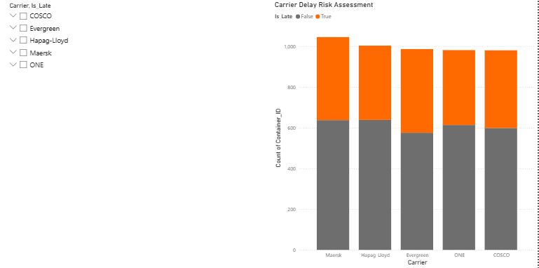

# 📊 B2B Logistics Routing & Customs Compliance Risk Model

*(Interactive Power BI Dashboard evaluating Carrier Lead Time and Customs Hold impact)*

 

## 📌 Executive Summary
A data-driven approach to optimizing carrier selection, mitigating supply chain bottlenecks, and reducing lead-time variability. By analyzing simulated historical shipping records for inbound shipments (e.g., routing from major Asian hubs to the Port of Vancouver) and integrating simulated customs clearance statuses, this project quantifies the operational and financial impacts of logistics delays and customs holds.

## 🚨 The Business Problem
Logistics operations often face significant friction due to unpredictable carrier performance and unexpected border compliance delays. Key operational challenges include:
* **Carrier Lead Time Variability:** Lack of granular visibility into which carriers exhibit the highest risk of late delivery across different shipping modes.
* **Customs Hold Bottlenecks:** Difficulty in quantifying the exact operational delay (in days) introduced when a container is placed on a CBSA (Canada Border Services Agency) or regulatory hold.
* **Proactive Risk Management:** The need for predictive insights that allow Supply Chain Planners to adjust inventory allocation before exceptions disrupt customer service levels.

## 💡 The Solution
This project leverages **Python** for baseline data generation and model structuring, paired with an interactive **Power BI Dashboard** to visualize key logistics and compliance metrics:
1. **Carrier Delay Risk Assessment:** Evaluates and compares the percentage of late versus on-time deliveries for major ocean carriers (e.g., COSCO, Maersk, Evergreen, ONE, Hapag-Lloyd).
2. **Customs Hold Impact Analysis:** Distributions of container volume across various clearance statuses (Released, Pending IID, CBSA Hold) to pinpoint precise time-loss factors.
3. **Interactive Slicers:** Allows operational managers to filter performance data dynamically by carrier or logistics parameters to drive data-backed routing decisions.

## 🚀 Business Impact & Operational Value
* **Enhanced Carrier Selection:** Identifies high-risk carriers, enabling the procurement team to optimize container booking allocations and negotiate stronger SLAs.
* **Reduced Lead-Time Variance:** Quantifies the exact time penalty of customs check bottlenecks, allowing planners to build more accurate safety stock buffers.
* **Proactive Customer Service:** Empowers logistics coordinators to shift from reactive firefighting to proactive exception management, safeguarding downstream retail or distribution fulfillment.

## 🛠️ Technical Stack
* **Data Engineering & Simulation:** Python (Pandas, NumPy)
* **Business Intelligence & Visualization:** Power BI Desktop
* **Domain Knowledge Applied:** International Trade Compliance, Carrier Performance KPIs, Supply Chain Operational Excellence
